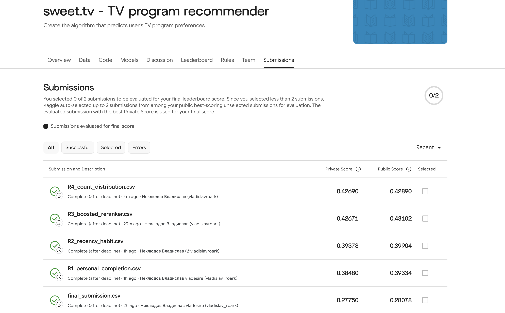

# Completion-Aware Television Recommendation

**Vladislav Neklyudov | Individual | vsneklyudov@edu.hse.ru | 2026-11-01**

Assignment: LLM4Rec/FKN individual exam

GitHub: TODO: accessible GitHub repository URL

**DRAFT: required external/personal evidence pending**

## Abstract

This study predicts five preferred television programme IDs for each of 1,260 SWEET.TV users from sparse viewing logs and broadcast schedules. It compares popularity, content filtering, implicit matrix factorization and completion-aware behavioral models, then combines a chronological boosted reranker with a small sampled count-distribution ranking. The designated R4 file obtained a user-reported private MAP@5 of 0.42690; its corrected development proxy MAP@5 was 0.271272. Personalized recurring preferences improved the recorded results, while the final distributional addition produced only a very small gain and does not establish reliable superiority.

## 1. Introduction and related work

The service needs recommendations for programmes that will actually air: a regular news viewer might receive the next occurrence of a familiar programme, while a children’s-TV household has different recurring preferences. The contribution is an auditable log-to-broadcast pipeline and a comparison that preserves eligibility, repeats and evaluation users across methods. Sparse programme labels and an unspecified hidden preference construction make accurate target reconstruction essential.

The dataset and competition define ranked five-ID predictions [1]. Implicit ALS separates positive preference from confidence [2,4]; content filtering uses sparse TF-IDF attributes [3]. A historical participant describes completion and frequency targets [5,6], motivating our explicit proxy rather than proving the hidden evaluator. A compact histogram boosted classifier [7] combines temporal signals. Association rules and PageRank were considered but deferred because content filtering and genuine ALS already satisfy the two-method requirement; further graph infrastructure would consume time without diagnosed benefit.

## 2. Method: observations, targets and leakage

The five CSVs contain 5,821,987 viewing rows from 4,914 users. Viewing duraton and schedule duration are seconds; timestamp subtraction defines viewing intervals where 117 recorded durations disagree. User IDs remain exact strings. Dates share the dataset’s naive clock; no timezone correction was invented. Matching uses vsetv_id=channel_id and half-open overlap max(0,min(view_end,airing_end)-max(view_start,airing_start)), with a sorted channel join covering every intersected broadcast.

Only 10.762% and 11.309% of rows in the two historical schedules have nonzero programme IDs. Zero IDs are missing labels, not dislikes. Canonicalization removes one nonpositive and ten conflicting schedule rows, including one labelled row. Seventeen duplicate views are removed; 311,644 same-channel fragments merge. A later different-channel record interrupts the previous session: 351,499 sessions lose overlapping coverage. No device ID exists, making this a conservative single-stream assumption. Labelled broadcasts cover 52.71% of retained session seconds.

A qualifying watch covers at least 80% of the ORIGINAL broadcast duration in one uninterrupted channel session; each user-airing contributes at most once. Clipping at a split retains that full denominator. Labels are each user’s up-to-five programme IDs with highest qualifying broadcast frequency, ties ascending integer ID. This is a declared proxy; hidden thresholds, continuity and ties remain uncertain. Aggregate-sitting and alternate-tie sensitivities are separate.

Development fits before 1 June 2020 and predicts [1 June,29 June); all 1,260 template users remain, including 362 empty-target users scored zero. There are 898 nonempty and 642 five-label users, 3,929 eligible candidates, 4,745 fitting users and 109,256 user-programme pairs from 299,059 qualifying user-airings. AP@5 sums precision at each relevant recommended rank and divides by min(5, the complete distinct relevance-set size); empty relevance scores zero. Unreachable labels remain in the denominator. Every model permits repeats and ranks only target-scheduled nonzero IDs. Missing scores use the same qualifying distinct-user popularity fallback, then ID ties, without duplicates. Vectorizers and learned features use only each cutoff’s past; future schedules supply availability, channel, time and duration, never viewing or learned future metadata.

<!-- pagebreak -->

## 3. Models, selection and experiments

Content uses category, genres, production year, director, actors and title tokens with prefix-only TF-IDF; a normalized log(1+qualifying count)-weighted user profile ranks cosine similarity. Unseen metadata items have no content score and use fallback. CPU ALS has 32 factors, 15 iterations, regularization 0.1, seed 42 and one thread; observed confidence is 1+10 log(1+count), unobserved confidence 1, library alpha=1. Factor orientation/mapping was checked and repeat filtering explicitly disabled.

R1 ranks personal qualifying counts, breaking ties by latest qualified end then ID. R2 uses 56-day decay and 75% repeat/25% pooled channel/time-habit forecast; coarse weekday/weekend six-hour cells shrink by 20 opportunities. No/28/56-day decay and a small blend grid were compared; pure opportunity adjustment failed locally. R3 generates 200 candidates (personal100, R2new50, ALS30, content15, popularity5, then fill) and ranks 23 features with HistGradientBoostingClassifier: binary log-loss, 31 leaves, L2=5, learning rate .05, 160 trees, minimum leaf100, bins63. Counts are per-week/share normalized and history length is explicit. ALS/content supply candidates, but removing their numeric scores improved development MAP.

R3 training examples forecast March23-April20 and April6-May4 using only earlier histories; these target windows overlap. The May4-June1 inner window selects two compact configurations with chronological early stopping checks; both reach the 160-tree cap. Development labels never fit its evaluated model. Production adds eligible earlier training examples, while features refit before July27. The production schedule is July27-October19 noon (84.5 days), much longer than development.
| Method, identical June proxy | MAP@5 | Fit / infer seconds | Cold / lists |
|---|---:|---|---|
| R0 strategy replay | 0.173207 | 0.011 / 0.034 | 0 full fallback / 1 |
| Completion popularity | 0.195555 | 0.004 / 0.027 | 0 full fallback / 1 |
| Content | 0.187332 | 0.104 / 0.167 | 17 full fallback / 852 |
| ALS | 0.152013 | 0.751 / 0.049 | 17 full fallback / 1102 |
| R1 personal | 0.250764 | 0.004 / 0.020 | 19 full fallback / 1217 |
| R2 | 0.257532 | 0.077 features / 0.139 rank | 17 / 1219 |
| R3 | 0.271132 | 15.679 combined development fit/predict | 17 cold histories |
| R4 mean / membership / expected AP | 0.253992 / 0.256944 / 0.257600 | 113.583 s whole R4 round | Same population/pool |
| R4 final 90/10 blend | 0.271272 | Included in whole-round time | 1191 production lists; 5 fallback users |
R3 pool micro recall is 3281/3844=0.853538, oracle MAP@5=0.599987, actual R3=0.271132. Recall pools labels; oracle averages per-user attainable AP including empty users, so these are different quantities. The oracle is a ceiling, not achieved performance. R3 without schedule/habit features scores .264500; full29 features .269543; R3/R2 blends .265066/.269370.

R4 uses Beta-Binomial counts: a=100*mu+n, b=100*(1-mu)+A-n, N~BetaBinomial(M,a,b). Historical opportunity A spans each user’s observed history; n<=A is checked; M counts future available airings. User-channel priors shrink20 toward historical population rates, never R3 probabilities. Kappa5/20/100 is selected on the inner window. Seed42, 512 independent programme draws form positive-count Top-5 sets with the declared ties; a larger modeling pool includes scheduled personal history, top500 means and the unchanged rec200. Greedy expected-AP ranking uses exact sampled marginal/pair moments and the actual sampled set-size denominator. Final score is .9/(60+R3 rank)+.1/(60+distribution rank).

The frozen R4 shortlist opened the later June29-July27 corrected audit once: R3 .331066, blend .331476. That audit was used for selection; old broad labels had already exposed the period. Development delta .000140 has paired-bootstrap95% interval [-.001468,.001834]; 34 users improve,31 worsen. Pure distributions lose to R3; blend stability held for30 checked users, while pure distribution lists were unstable. No independent final-test claim is made.

<!-- pagebreak -->

## 4.1. Same-user recommendation evidence

**User 8848657562275607589**: 13 fitting programmes and 15 qualifying broadcasts. The same users were selected for contrasting history lengths, near low/high percentiles in the initial protocol. Corrected proxy histories are supplied in experiments/R1/formal_two_user_histories.csv. Target IDs: 10003144.
| Method | Ordered Top-5 IDs (left to right) | AP@5 |
|---|---|---:|
| R0 replay | 2400480 240081 6500479 2400508 2400467 | 0.000 |
| Popularity | 2400480 240081 2400467 2400508 20088 | 0.000 |
| Content | 2400508 5900256 5900275 2400467 5900484 | 0.000 |
| ALS | 240081 2400480 2400508 2400467 20088 | 0.000 |
| R1 | 2400467 2400508 12002955 12001682 90079091 | 0.000 |
| R2 | 2400467 2400508 12001682 12002955 5900256 | 0.000 |
| R3 | 2400508 12001682 2400480 12002955 2400467 | 0.000 |
| R4 | 2400508 12001682 2400480 12002955 2400467 | 0.000 |
The following lookup supplies the title and category for every ID above. Full scores and ordered records are in experiments/final/two_user_examples.json. Titles describe one observed metadata record of a recurring programme ID, not necessarily the exact future episode.
| ID | Programme title | Category |
|---|---|---|
| 20088 | 'Завтрак с 1+1'. Информационно-развлекательная программа. | Развлечения |
| 240081 | Факты. День. | Инфо |
| 2400467 | 'Викна-Новости'. | Инфо |
| 2400480 | ТСН. Неделя. | Инфо |
| 2400508 | Сегодня. Итоги с Олегом Панютой. | Инфо |
| 5900256 | Утро с Украиной. | Инфо |
| 5900275 | 'Утро России'. | Инфо |
| 5900484 | Премьера. 'С бодрым утром!'. | Инфо |
| 6500479 | 'Мир наизнанку'. | Познавательное |
| 12001682 | М/с 'Губка Боб Квадратные Штаны'. | Детям |
| 12002955 | М/с 'Свинка Пеппа', 1 с. 'Лужи'. | Детям |
| 90079091 | Х/ф 'Фото на недобрую память'. | Фильмы |
All methods miss this user’s single held-out target. Familiar history is insufficient: this is a concrete cold-item/preference-shift failure, not a useful-discovery success. Missing historical metadata is reported explicitly rather than inferred from future features.

An actual preparation error used pandas Series.item as if it were a column value; explicit row["item"] indexing fixed example serialization and the full pipeline/checks passed. Agent checks cover raw-row overlap examples, split clipping, AP examples 11/12 and 8/15, empty labels and duplicate rejection, ALS orientation/repeats, sample expected-AP identity versus exhaustive tiny cases, bounded counts, finite scores, exact CSV schema/order/eligibility and deterministic reconstruction. R1-R3 cached reproductions and R4 full production resampling passed; a second clean-clone full rerun was not performed.

<!-- pagebreak -->

## 4.2. Same-user recommendation evidence

**User 7124081213039446293**: 76 fitting programmes and 129 qualifying broadcasts. The same users were selected for contrasting history lengths, near low/high percentiles in the initial protocol. Corrected proxy histories are supplied in experiments/R1/formal_two_user_histories.csv. Target IDs: 20088, 240081, 2400480, 12001682, 90073541.
| Method | Ordered Top-5 IDs (left to right) | AP@5 |
|---|---|---:|
| R0 replay | 2400480 240081 6500479 2400508 2400467 | 0.400 |
| Popularity | 2400480 240081 2400467 2400508 20088 | 0.520 |
| Content | 12001682 700389 12001734 240081 400357 | 0.300 |
| ALS | 1000723 1000381 2500430 10002451 700389 | 0.000 |
| R1 | 12001682 240081 12001734 700389 2400480 | 0.520 |
| R2 | 12001682 12001734 240081 700389 2400480 | 0.453 |
| R3 | 12001682 240081 2400480 12001734 20088 | 0.760 |
| R4 | 12001682 240081 2400480 12001734 20088 | 0.760 |
The following lookup supplies the title and category for every ID above. Full scores and ordered records are in experiments/final/two_user_examples.json. Titles describe one observed metadata record of a recurring programme ID, not necessarily the exact future episode.
| ID | Programme title | Category |
|---|---|---|
| 20088 | 'Завтрак с 1+1'. Информационно-развлекательная программа. | Развлечения |
| 240081 | Факты. День. | Инфо |
| 400357 | 'Холостяк', 10 сезон, 1 эп., 1 ч. | Развлечения |
| 700389 | Кто сверху?, 6 сезон, 7 эп. | Развлечения |
| 1000381 | Т/с 'CSI: Место преступления', 7 сезон, 6 и 7 с. | Сериалы |
| 1000723 | Т/с 'Охотники за древностями', 3 сезон, 14 и 15 с. | Сериалы |
| 2400467 | 'Викна-Новости'. | Инфо |
| 2400480 | ТСН. Неделя. | Инфо |
| 2400508 | Сегодня. Итоги с Олегом Панютой. | Инфо |
| 2500430 | 'Затерянный мир'. | Познавательное |
| 6500479 | 'Мир наизнанку'. | Познавательное |
| 10002451 | Т/с 'Великолепный век', 39 и 40 с. | Сериалы |
| 12001682 | М/с 'Губка Боб Квадратные Штаны'. | Детям |
| 12001734 | М/с 'Волшебные покровители', 161 с. 'Женат на мамочке'. | Детям |
Compare the children’s-programme training history with the target set and ordered lists. Hits support recurring-preference prediction for this observed period; misses do not demonstrate lack of enjoyment or that a programme was never watched elsewhere.

Environment:macOS26.6.2 arm64 CPU, Python3.15.0, numpy2.5.4, pandas3.1.0, scipy1.18.1, scikit-learn1.9.1, implicit0.7.3, reportlab5.1.0, pymupdf1.28.2; seed42. Hashes, counts, checks and stage times are saved under results/ and experiments/R1-R4/.

<!-- pagebreak -->

## 5. Discussion, verification and AI disclosure

**Student interpretation:** TODO: Review the two-user examples and rewrite the interpretation in your own words.

**Personal join reasoning:** TODO: Personally inspect a raw viewing/schedule overlap and explain your arithmetic.

**Personal AP reasoning:** TODO: Personally recompute the saved real user's AP@5 and explain your reasoning.

Agent assessment: choose R4 by the agreed maximum returned private score, while R3 supplies almost all of its ranking. Content/ALS perform worse than completion popularity here; metadata similarity and factor objectives differ from recurring-favourite labels. More detailed behavioral signals improve R1-R3, but the R4 gain is tiny. Sparse labelled schedules, implicit background viewing, ambiguous devices, independent count draws, truncated competitors and unequal availability/exposure limit interpretation. A next improvement is out-of-time calibration on a longer horizon before adding complexity. No A/B, enjoyment or revenue effect was measured.
| Submission | Public | Private |
|---|---|---|
| R0 | not recorded | approximately .27 |
| R1 | .39334 | .38480 |
| R2 | .39904 | .39378 |
| R3 | .43102 | .42671 |
| R4 designated | .42890 | .42690 |
Scores above are user-reported until supported by the genuine screenshot. Five uploads include four adaptive private-score queries; they are not an untouched test. Original R0 local .595717 used broad five-minute labels and is historical only, not comparable with this table’s development proxy.

Designated CSV: submissions/R4_count_distribution.csv; SHA-256: e3e6e7a74d12c3ffb8bc15054b4a5373007d1f1e1eb0e019fbc89c4fa08da2d6. Submission ID/status: TODO: designated final submission identifier / TODO: wait for COMPLETE. Description: TODO: full Russian name and Kaggle username entered on the designated submission.

ChatGPT assisted upstream planning and subsequent research plans; local Codex generated/debugged code, searched sources, executed experiments/checks and drafted this report. Python libraries calculated results. Model/app versions not exposed reliably were not invented. Algorithms were reimplemented; no external predictions or classmates’ reports were imported. The proposed rate-model paper could not be retrieved and is not claimed as consulted. Personal statements above are student-supplied only when completed; other checks are agent-executed. Library internals, hidden scorer conventions and transfer assumptions were not independently proven.

Native audit: rollout-2026-11-01T14-39-42-01a196e8-8117-7b61-a05e-d4d86d8f1472.jsonl (original JSONL; guidelines permit tool-native logs although examples use .json). Student copies it unchanged after final work; it excludes earlier ChatGPT activity. No export was reconstructed, converted or sanitized. Personal checks completed: False; student report review: False.

<!-- pagebreak -->

## References

[1] sweet.tv, “sweet.tv - TV program recommender,” Kaggle, 2020. [Competition and data](https://www.kaggle.com/competitions/sweettv-tv-program-recommender/data). Accessed 2026-11-01: downloaded CSVs and student-provided evaluation description inspected; public page did not expose readable metric details.

[2] Y. Hu, Y. Koren, and C. Volinsky, “Collaborative Filtering for Implicit Feedback Datasets,” Proc. IEEE ICDM, pp.263-272, 2008, doi:10.1109/ICDM.2008.22. [Author-hosted paper](https://yifanhu.net/PUB/cf.pdf). Consulted 2026-11-01.

[3] Scikit-learn developers, “Feature extraction,” official documentation. [Feature extraction](https://scikit-learn.org/stable/modules/feature_extraction.html). Consulted 2026-11-01.

[4] B. Frederickson and implicit contributors, “AlternatingLeastSquares,” Implicit API documentation. [CPU ALS](https://benfred.github.io/implicit/api/models/cpu/als.html). Consulted 2026-11-01; documentation 0.7.2, installed library0.7.3.

[5] N. Melentev, “Two-layered recommender system methodology: A prize-winning solution,” Towards Data Science/Medium. [Participant article](https://medium.com/data-science/two-layered-recommender-system-methodology-a-prize-winning-solution-c4bdb815b156). Consulted 2026-11-01; methodological lead, not our results.

[6] ndmel, “2nd_place_recsys_cinema_challenge_2020: utils.py,” GitHub source. [Target construction](https://github.com/ndmel/2nd_place_recsys_cinema_challenge_2020/blob/main/utils.py). Consulted 2026-11-01; completion/frequency idea reimplemented, no copied predictions.

[7] Scikit-learn developers, “HistGradientBoostingClassifier,” official API documentation. [Classifier API](https://scikit-learn.org/stable/modules/generated/sklearn.ensemble.HistGradientBoostingClassifier.html). Consulted 2026-11-01; installed1.9.1 API checked.
